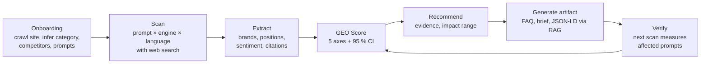
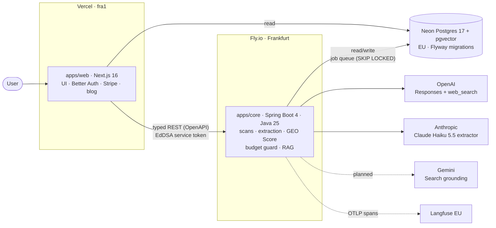
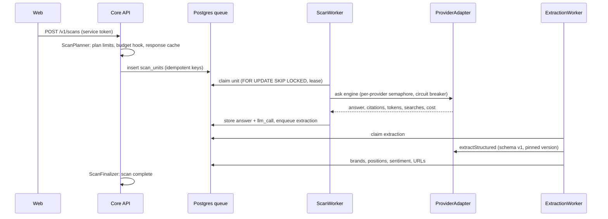
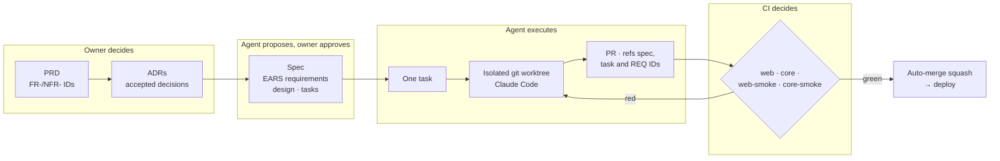

# GEOMASTER

**Measure how ChatGPT, Gemini and Claude talk about your brand, then fix what they get wrong.**

GEOMASTER is a GEO (Generative Engine Optimization) visibility SaaS for Swiss and DACH companies. It asks real questions to AI assistants with web search turned on, in EN, DE, FR and ES, extracts which brands they recommend and which pages they cite, and turns the gaps into recommendations whose impact is verified on the next scan.

[](https://github.com/franciscojgonzalezfernandez-lgtm/geomaster/actions/workflows/ci-web.yml)
[](https://github.com/franciscojgonzalezfernandez-lgtm/geomaster/actions/workflows/ci-core.yml)
[](https://github.com/franciscojgonzalezfernandez-lgtm/geomaster/actions/workflows/ci-smoke.yml)
[](https://github.com/franciscojgonzalezfernandez-lgtm/geomaster/actions/workflows/deploy-core.yml)

| | |
| --- | --- |
| **Web** | https://geomaster-coral.vercel.app (custom domain geo-masterizer.com coming with the beta) |
| **Core API** | https://geomaster-core.fly.dev/actuator/health |
| **Status** | Pre-beta, in production since 2026-11-24 · closed beta 2026-12-14 · public launch 2027-02-15 |
| **Repository** | Private · public case study at launch, access on request |

---

## Why this exists

When someone asks an AI assistant for a recommendation, the answer names two or three brands and the decision is made right there, often without visiting a single website. A brand that is not named doesn't drop a position: it drops out of the conversation, and today it has no reliable way to find out.

Three things make this hard to measure, and they shape the whole design:

1. **Answers are not deterministic.** One query is an anecdote, not a data point. GEOMASTER treats every answer as a sample and publishes every metric with a 95 % confidence interval.
2. **Visibility depends on language and place.** In Switzerland the same business competes in DE, FR and EN. Language, country and region are parameters of every measurement, not an afterthought.
3. **Knowing is not enough.** Each recommendation comes with literal evidence, a range of potential points (not an optimistic ceiling), and a before/after check on the prompts it affects.

The first real customer is the author's own snowboard school, [rideflumserberg.ch](https://rideflumserberg.ch) (baseline mention rate 20 %, September 2026).

## How it works



### The GEO Score

A weighted average of five axes, computed over a rolling window of the last four weekly scans:

```
GEO = 0.35·Presence + 0.20·Prominence + 0.20·Share of voice + 0.15·Authority + 0.10·Technical
```

| Axis | What it measures |
| --- | --- |
| Presence | Answers that mention the brand ÷ all answers |
| Prominence | How early the brand is named: mean of max(0, 1 − (position − 1) ÷ 5) |
| Share of voice | Brand mentions ÷ mentions of brand + competitors |
| Authority | Answers citing the brand's own domain ÷ answers with citations |
| Technical | Weighted site audit: AI bots in robots.txt, `llms.txt`, structured data, sitemap, `hreflang`, content without JavaScript |

**Statistical rules:** Wilson intervals for proportions, bootstrap for the composite score. Any breakdown with fewer than 30 answers shows "insufficient data" instead of a number. Each scan stores the formula, extractor and model versions, so a version change is visible in the trend line. Every number links back to the literal answers behind it.

The rolling window is a deliberate cost trade-off: four weekly scans give repeated samples, and therefore intervals, without multiplying API calls.

## Architecture

Two deployables in one monorepo. **`apps/web`** (Next.js) owns UI, auth, billing and content. **`apps/core`** (Java + Spring Boot) owns the domain: scans, extraction, scoring, agents and RAG. They share a Postgres database (schema owned by core), an OpenAPI contract and a single plan-limits file.



### Life of a scan



### Boundaries (enforced, not suggested)

| Rule | Why |
| --- | --- |
| Only `apps/core` calls LLM providers | One place for cost tracking, budget guard and model portability |
| Only Flyway migrations in core change the schema | One schema owner, no migration races between two apps |
| `apps/core` never renders HTML | Lighthouse, SEO and i18n stay in one place (web) |
| Plan limits live only in [`packages/plans/plans.json`](packages/plans/plans.json) | One source of truth for product, pricing page and core |
| Core API changes regenerate `packages/api-contract` in the same PR | CI fails on contract drift |
| Every tenant-owned query filters by `account_id` | Isolation between customers is structural, not a convention |

## Key decisions and why

All decisions are recorded as ADRs in [`docs/adr/`](docs/adr/). The ones that shape the system most:

| Decision | Reason | ADR |
| --- | --- | --- |
| **Java 25 + Spring Boot 4 core, Next.js web** | The domain (queues, retries, statistics, agents) suits a typed, long-running JVM service with virtual threads; the web stays on the best SSR/i18n/SEO stack. Polyglot on purpose. | [0003](docs/adr/0003-core-java-spring-boot.md), [0002](docs/adr/0002-web-nextjs-static-first-i18n.md) |
| **Polyglot monorepo: pnpm + Turborepo + Gradle** | One PR can change the API, the contract and the UI together; shared plan limits and i18n. | [0001](docs/adr/0001-monorepo-turborepo-pnpm-gradle.md) |
| **Job queue in Postgres (`SKIP LOCKED`), no Kafka or Redis** | The business has a hard ceiling of CHF 400/month in losses. Postgres already gives transactional, retry-safe claims with leases; one less service to run and pay for. | [0004](docs/adr/0004-postgres-job-queue.md) |
| **Postgres 17 + pgvector, Flyway owns the schema** | RAG vectors live next to the tenant data they belong to, with the same isolation and backups; hybrid retrieval without a separate vector DB. | [0005](docs/adr/0005-postgres-pgvector-flyway.md), [0008](docs/adr/0008-rag-pgvector-hybrid-retrieval.md) |
| **Own `ProviderAdapter` over official SDKs** | No LLM framework lock-in. Switching models is configuration; every call records provider, model, version, tokens, searches and real cost. | [0007](docs/adr/0007-provider-adapter-official-sdks.md) |
| **Better Auth in web, EdDSA JWT + JWKS to core** | Core trusts short-lived signed tokens it verifies against web's public keys; no shared secret, no session lookup across services. SSO-ready for Enterprise. | [0017](docs/adr/0017-auth-better-auth-jwks.md) |
| **OpenAPI generated by core, typed client in web** | The Java code is the contract; TypeScript types are generated, and drift fails CI. | [0016](docs/adr/0016-api-contract-openapi.md) |
| **Vercel + Fly.io, both in Frankfurt; Neon Postgres in the EU** | Data stays in the EU for Swiss nDSG and GDPR; low latency between web, core and database. | [0006](docs/adr/0006-hosting-vercel-flyio-frankfurt.md) |
| **OpenTelemetry → Langfuse, no prompt text by default** | Traces per scan and per LLM call with cost; customer content is not exported unless explicitly enabled. | [0012](docs/adr/0012-observability-otel-langfuse-sentry.md) |
| **Merge on green CI** | Solo developer at ~10 h/week: CI (tests, contract drift, Lighthouse, evals) is the gate. An earlier agent-review gate was tried and dropped. | [0019](docs/adr/0019-merge-on-green-ci.md) (supersedes [0018](docs/adr/0018-automated-pr-review-auto-approval.md)) |

## In production

| Piece | Where | How it deploys |
| --- | --- | --- |
| Web | Vercel, functions in `fra1` | Vercel GitHub integration on push to `main`; preview per PR |
| Core | Fly.io `geomaster-core`, Frankfurt, shared-cpu-1x 1 GB, always on (workers poll the queue in-process) | [`deploy-core.yml`](.github/workflows/deploy-core.yml) on push to `main` |
| Database | Neon Postgres 17 (EU). Web uses the pooled URL; core uses direct JDBC. Flyway migrates on core boot | — |
| Traces | Langfuse EU over OTLP. Spans: `scan.plan`, `scan.unit`, `chat <model>`, `scan.finalize` | — |
| Secrets | Vercel env and `fly secrets` only; never in the repo | — |

Fixed infrastructure costs are about CHF 100/month, which is the point: break-even at roughly five paying customers.

## Integrations built so far

| Integration | What it does | Status |
| --- | --- | --- |
| **OpenAI Responses API** + `web_search` | Measures ChatGPT answers with user location and a hard cap on searches per call | ✅ live in production |
| **Anthropic — Claude Haiku 5.5** | Structured brand extraction (schema v1, version fingerprint pinned by a test, grounding check against the literal answer) | ✅ built |
| **Better Auth** | Magic-link sign-in (via Resend) and Google OAuth, organizations, JWT plugin with JWKS endpoint | ✅ live |
| **Langfuse / OpenTelemetry** | Per-scan and per-call traces with cost | ✅ live |
| **Neon Postgres + pgvector** | Primary store and queue | ✅ live |
| **Gemini** + Google Search grounding | Measures Gemini answers; shows the Google Search Suggestions Google requires | ⏳ next |
| **Claude** + web search tool | Measures Claude answers | ⏳ next |
| **Stripe** | Checkout, customer portal, CHF and EUR | 🗓 launch |
| **Resend + React Email** | Scan-complete and weekly digest emails | 🗓 launch |

## Engineering highlights

- **Idempotent, retry-safe scan units.** A partial scan completes on retry without re-asking what it already has.
- **Resilience per provider.** Per-engine concurrency semaphores and a circuit breaker: one provider down never blocks the other two.
- **Cross-account response cache.** The same prompt, engine, language, location and day runs once, even when several accounts track it.
- **Budget guard.** Every scan is planned through a `BudgetGuard` hook. The policy lands before launch: if the monthly forecast exceeds the loss ceiling, pause the free tool first, then new free scans, and never paid scans.
- **Real cost on every call.** Tokens, web searches and price are stored per `llm_call`, so unit economics come from measurements, not estimates.
- **Weekly scheduler** with a Postgres advisory lock, so it is safe with more than one instance.
- **Tenant isolation** through a `TenantContext` populated from the verified service token; every repository query is scoped by `account_id`.
- **Tests:** JUnit + Testcontainers (real Postgres + pgvector) in core, Vitest and Playwright in web, plus a smoke job that boots core against an ephemeral database and runs Lighthouse on the web.
- **Extractor evals as a CI gate** (planned): precision ≥ 95 %, recall ≥ 90 % on a labelled, versioned dataset in four languages.

## How it is built: AI-first, spec-driven

GEOMASTER is also a portfolio piece for agentic software development. One person builds it at about 10 hours a week. AI agents write most of the code, and the owner decides what gets built and why. The process exists so that agents can work fast without drifting: every line of code traces back to a written decision, and CI decides what merges.

### The flow



| Step | Who | Artifact | What happens |
| --- | --- | --- | --- |
| 1. Product | Owner, with Claude in a planning chat | [`docs/PRD.md`](docs/PRD.md) | Problem, users, economics, requirements with stable IDs (`FR-SCN-05`, `NFR-02`) and phase tags (beta / launch). Product discussion happens in Spanish; repository artifacts are in English. |
| 2. Decisions | Owner, agent drafts | [`docs/adr/`](docs/adr/) | Each architectural choice is an ADR with context, options and consequences. Agents must never contradict an accepted ADR; to change course they propose a superseding one. |
| 3. Spec | Agent drafts from [`specs/_template/`](specs/_template/), owner reviews | `specs/<feature>/requirements.md`, `design.md`, `tasks.md` | Requirements in EARS form (`WHEN … THE SYSTEM SHALL …`) that trace to PRD IDs and the ADRs that constrain them. The design names classes, tables and endpoints. Tasks are sized so that one task is about one PR. |
| 4. Implementation | Claude Code, one session per task | A branch in its own git worktree | The agent reads [`CLAUDE.md`](CLAUDE.md), the PRD, the architecture and the spec, implements **only** that task with its tests, regenerates the API contract if an endpoint changed, and ticks the task in `tasks.md`. |
| 5. Pull request | Agent | PR with Conventional Commit title | The body lists what changed and `Refs: specs/<feature> T<n>, REQ-…`. Target is < 400 changed lines. |
| 6. Gate | CI | Four required checks | Unit and Testcontainers tests, typecheck and lint, contract drift, a smoke boot against an ephemeral database, and Lighthouse budgets. |
| 7. Merge and deploy | [`auto-merge.yml`](.github/workflows/auto-merge.yml) | Squash on `main` | Auto-merge is enabled on every non-draft PR; it merges as soon as the checks pass. The merge triggers the Vercel deploy and [`deploy-core.yml`](.github/workflows/deploy-core.yml). |

A real example: commit `feat(core): extraction queue and worker with grounding, cost and spans (extraction-analysis T5)` implements task T5 of [`specs/extraction-analysis/tasks.md`](specs/extraction-analysis/tasks.md), references `REQ-4, REQ-10, REQ-16, REQ-19`, adds migration `V7`, and merged by itself when CI went green.

### Guardrails that make it safe to let agents merge

- **Written boundaries.** [`CLAUDE.md`](CLAUDE.md) lists rules agents cannot break: only core calls LLMs, only Flyway changes the schema, no hard-coded plan limits, no secrets in code, logs or prompts, every tenant query filtered by `account_id`, all UI strings in four languages.
- **Tests are part of the task.** A task is not done without its tests; Flyway migrations are tested against real Postgres with Testcontainers, and applied migrations are never edited.
- **Contract drift fails CI.** If core's OpenAPI document and the committed TypeScript types differ, the PR cannot merge.
- **Version pins for AI behaviour.** The extractor's prompt, schema, model and parameters form a fingerprint pinned by a test; changing any of them is a visible, deliberate version bump, and extractor changes must pass the eval thresholds.
- **🔑 tasks.** Tasks that need a real provider API key are marked; CI runs them against recorded fixtures, and the owner verifies them against the live API.
- **The owner keeps the brake.** Any PR can be stopped by converting it to draft or disabling auto-merge.

### What did not work

The first version of this process ([ADR-0018](docs/adr/0018-automated-pr-review-auto-approval.md)) added a Claude review agent as a required check, plus a human-approval label for schema changes. In practice it blocked routine PRs (cancelled runs, branch updates, labels that did not stick) and cost more owner time than it saved. [ADR-0019](docs/adr/0019-merge-on-green-ci.md) replaced it with "merge on green CI": test quality became the only automated gate, so the specs now require tests for every task. Keeping the superseded ADR in the repository is deliberate. It records why the decision changed.

## Roadmap

### Specs in progress

| Spec | Done | What's left |
| --- | --- | --- |
| [Accounts & projects](specs/accounts-projects/tasks.md) | 13 / 15 | Core integration tests for provisioning and tenant isolation; self-service account deletion (nDSG/GDPR) |
| [Scan engine](specs/scan-engine/tasks.md) | 10 / 13 | Gemini adapter, Claude adapter, `providerSmoke` task against the real APIs |
| [Extraction & analysis](specs/extraction-analysis/tasks.md) | 7 / 10 | Eval dataset v1, extractor eval in CI, brands editor in web |

### Closed beta (from 2026-12-14)

- [ ] GEO Score with confidence intervals; Overview, Prompts, Competitors and Cited pages views
- [ ] Onboarding agent: crawl, category, competitors, editable prompt set (< 3 minutes)
- [ ] Recommendations with evidence, full lifecycle and verified impact
- [ ] Artifacts generated with RAG: content brief, FAQ block, JSON-LD schema
- [ ] Lightweight site audit (technical axis)
- [ ] Internal cost back-office
- [ ] UI in EN and DE

### Public launch (target 2027-02-15)

- [ ] Stripe billing: four plans, CHF and EUR, monthly and yearly
- [ ] Free tool: "Does my brand appear in ChatGPT / Gemini / Claude?" × 4 languages, Turnstile-protected
- [ ] Blog in four languages (MDX) with RSS
- [ ] Gap analysis with RAG, remaining artifacts (comparison, lead paragraph, `llms.txt`)
- [ ] Email notifications and weekly digest
- [ ] Full UI in EN, DE, FR and ES

### Operations

- [ ] Custom domain geo-masterizer.com on Vercel
- [ ] Verified sending domain on Resend for production magic links
- [ ] Environment configuration for Vercel preview deployments

**Later (designed for, not scheduled):** Perplexity, Copilot and Google AI Overviews; "model memory" mode without search; misinformation detector; Italian; Slack and GA4 integrations; public API; Enterprise SSO.

## Running locally

Prerequisites: Node 22+, pnpm 12 (`corepack enable`), Docker (local Postgres and Testcontainers). The Gradle toolchain downloads JDK 25 if it is missing.

```bash
pnpm install
docker compose up -d db
cp .env.example .env
pnpm build      # web, shared packages and the Java core
pnpm dev        # web and core in development mode
```

Other commands: `pnpm lint` · `pnpm typecheck` · `pnpm test` · `./gradlew :core:build` · `./gradlew :core:bootRun`.

LLM engines stay disabled locally until you set their key and enable flag (`OPENAI_ENABLED`, `EXTRACTOR_ENABLED`).

## Repository map

| Path | Content |
| --- | --- |
| `apps/web` | Next.js 16 App Router, TypeScript strict, Tailwind v4, next-intl, Better Auth |
| `apps/core` | Spring Boot 4.1, Java 25, virtual threads, JDBC, Flyway, springdoc OpenAPI |
| `packages/plans` | Plan limits (JSON, read by both TypeScript and Java) |
| `packages/api-contract` | OpenAPI document and generated TypeScript types |
| `packages/i18n` | UI strings in EN, DE, FR, ES |
| `packages/ui` | Design tokens and shared components |
| `docs/` | PRD, architecture overview, ADRs, handoff notes |
| `specs/` | Spec Driven Development, one folder per feature |

## Author

Built by **Francisco Javier González Fernández** (Gonzalez Fernandez Snowball Effect, Switzerland).
